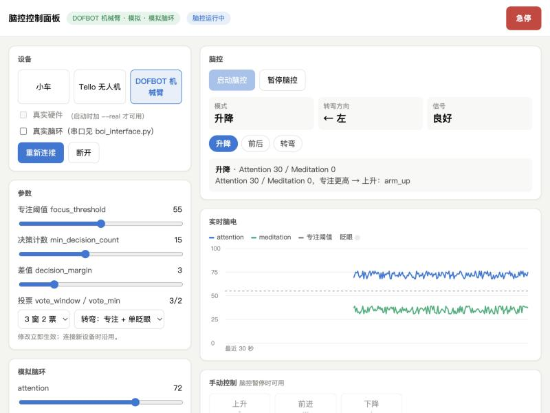

# 脑控统一控制面板（Control Panel）

一个本地网页：选择小车、无人机或机械臂，用同一套脑控方式控制。页面实时显示脑电、当前模式和解码结果，也可以手动按键控制，或一键急停。



## 启动

```bash
pip install flask          # 只有控制面板需要
python control_panel/app.py
```

然后在浏览器打开 <http://127.0.0.1:8765>。默认是**模拟设备 + 模拟脑环**：
- 设备不会真的运动；
- 页面左侧的滑块用来设置 attention / meditation / 信号质量；
- "单眨眼"/"双眨眼"按钮用来模拟眨眼。

这样不戴脑环也能演示和调试整套流程。

| 参数 | 默认 | 说明 |
|---|---|---|
| `--port` | 8765 | 网页端口，只监听 127.0.0.1，局域网其他机器访问不到 |
| `--real` | 关 | 允许在页面上勾选"真实硬件"。勾选后连接时还会弹出二次确认 |
| `--model-path` | `src/models/FinalModel.pth` | 转弯模式切到"模型"时使用的模型 |

"真实脑环"不需要 `--real`，串口仍在根目录 `bci_interface.py` 中配置。

## 页面功能

| 区域 | 内容 |
|---|---|
| 设备 | 选择小车 / Tello 无人机 / DOFBOT 机械臂，选择模拟或真实硬件、模拟或真实脑环，连接 / 断开 |
| 脑控 | 启动 / 暂停脑控；当前模式（升降、前后、转弯）、转弯方向、信号质量；最近一个窗口的解码结果和原因 |
| 实时脑电 | 最近 30 秒的 attention / meditation 曲线、专注阈值线、眨眼指示 |
| 手动控制 | 只显示当前设备支持的按钮。键盘：W/S 前后，A/D 左右，↑/↓ 升降，空格 静止，G 夹爪。脑控运行时手动按钮不可用 |
| 参数 | 专注阈值、决策计数、差值、多窗投票、转弯信号来源（规则 / 模型），修改立即生效 |
| 模拟脑环 | attention / meditation / poorSignal 滑块，单眨眼 / 双眨眼按钮。双眨眼会落在下一个窗口内 |
| 急停 | 右上角红色按钮或 **Esc**：立即停止脑控并执行安全动作（小车停止、无人机降落、机械臂复位） |
| 日志 | 每个窗口的解码、手动指令和急停记录 |

## 统一的控制方式

三种设备共用 `bin/control.py` 里的 `BrainControlSession`，规则完全一致：

- **模式**按 升降 → 前后 → 转弯 循环，只保留设备支持的模式。小车只有 前后 → 转弯；无人机和机械臂三种都有。
- **双眨眼**切换到下一个模式。
- **单眨眼**：
  - 转弯模式下切换左/右方向，本窗口不动作；
  - 其他模式下执行设备的附加动作（机械臂开合夹爪）。小车和无人机没有附加动作，单眨眼只提示"重新测量"。
- **升降 / 前后**：比较窗口内 attention 与 meditation 的计数：
  - 两者都低于"决策计数"，静止；
  - 两者相差小于"差值"，也静止；
  - 否则专注更高就上升/前进，放松更高就下降/后退。
- **转弯**：
  - 默认"专注执行、单眨眼换方向"：足够多的采样 attention ≥ 专注阈值时，向当前方向转一次；
  - 也可以切到"模型"：共享模型加置信度门控，置信度不够时静止。
- **多窗投票**默认关闭（机械臂默认 3 窗 2 票）。开启后，同一个意图要在最近几个窗口里赢得足够票数才执行。
- **安全**：
  - 脑环断开（poorSignal = 200）或急停时，执行设备的安全动作，并回到起始模式；
  - 信号差只报警不动作；
  - 无人机未起飞时只接受"上升"（起飞），其他动作会被拒绝。

各设备自己的 `brain_control.py` 命令行使用的是同一个会话，所以页面和命令行的行为一致。

## 结构

```text
control_panel/
  app.py          Flask 路由（只做 HTTP 转发）
  devices.py      设备注册：三个设备的配置类和 build_device（不依赖 Flask，口令测试也用它）
  static/index.html  页面（原生 JS + canvas，不依赖 CDN，离线可用）
bin/hub.py        ControlHub：设备 / 脑环 / 脑控线程的生命周期、手动指令、急停、事件广播
bin/control.py    BrainControlSession：统一的模式状态机和解码
MI-*/*_device.py  各设备适配器：把意图映射为硬件动作，以及安全动作
```

HTTP 接口（页面就是用它们实现的，也可以用脚本调用）：

| 接口 | 作用 |
|---|---|
| `GET /api/state` | 当前状态（设备、模式、方向、参数、最近一次解码） |
| `POST /api/connect` | `{"device": "car" \| "drone" \| "arm", "real_hardware": false, "real_headset": false, "confirm": false}` |
| `POST /api/disconnect` | 断开设备（无人机会先降落，机械臂会复位） |
| `POST /api/brain/start` / `stop` | 启动 / 暂停脑控 |
| `POST /api/command` | 手动指令 `{"intent": "forward" \| "backward" \| "left" \| "right" \| "up" \| "down" \| "rest" \| "aux"}` |
| `POST /api/emergency` | 急停 |
| `POST /api/config` | 修改参数，例如 `{"focus_threshold": 60}` |
| `POST /api/sim-headset` | 模拟脑环，例如 `{"attention": 80, "meditation": 20, "blinks": 2}` |
| `GET /api/stream` | Server-Sent Events 实时推送：`state`、`sample`、`report`、`action`、`log` |

## 真机使用建议

1. 先用模拟设备加**真实脑环**连接，确认曲线正常、眨眼能被识别，并调好专注阈值。
2. 再用 `python control_panel/app.py --real` 启动，逐个设备切到真实硬件。第一次只用手动按钮和急停。
3. 确认急停有效后再启动脑控。无人机请在开阔场地测试，机械臂周围不要放东西。
