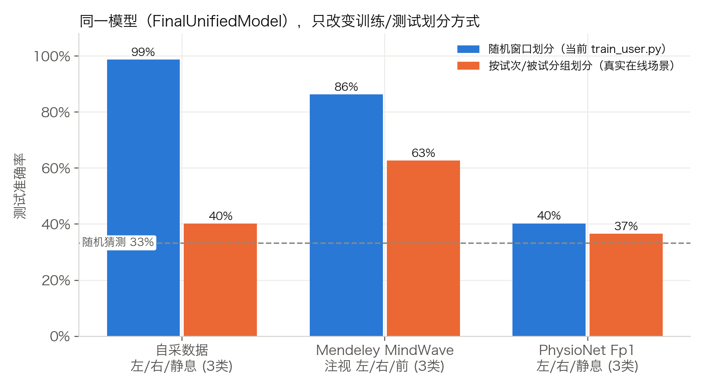
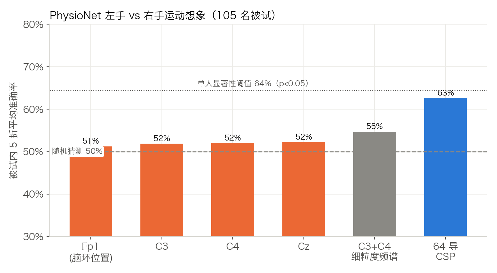
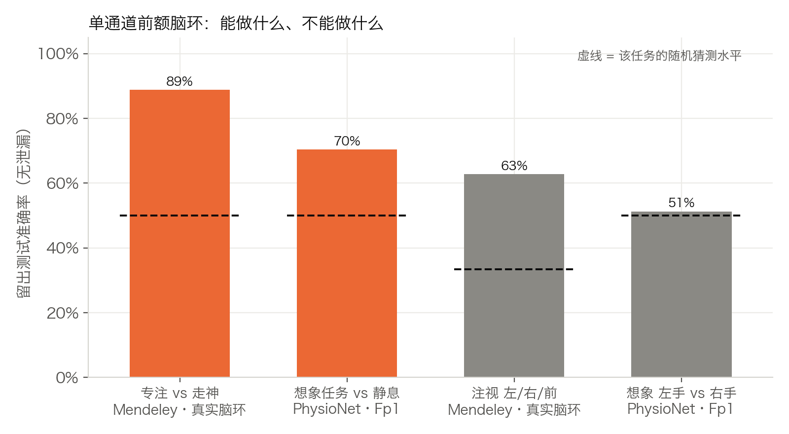
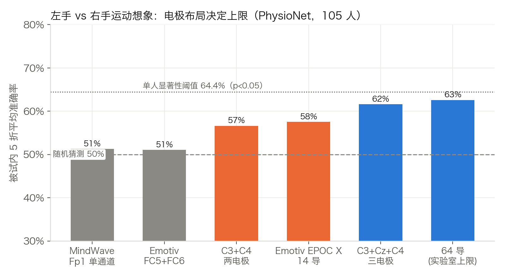

# 公开数据集基准测试（Public Dataset Benchmark）

用公开 EEG 数据集检验我们的单通道脑环训练流程：**同一套特征 + 同一个 `FinalUnifiedModel`**，只把数据换成别人采集的、带可靠标签的数据，看看模型到底学到了什么。

## 快速开始

```bash
# 1. 下载数据（Mendeley ≈ 0.6 MB；PhysioNet 3 个想象 run × 109 人 ≈ 800 MB，走 AWS 镜像约 4 分钟）
python experiments/public_datasets/datasets.py

# 2. 运行全部评测（约 5 分钟，CPU 即可），结果写入 results.json
python experiments/public_datasets/run_benchmark.py

# 3. 生成图表到 figures/
python experiments/public_datasets/make_figures.py
```

可选参数：`--only own|mendeley|physionet|csp`（`csp` 只重跑下面第 4 节的电极布局对比，约 15 秒，并合并进 `results.json`）、`--subjects N`（只用前 N 名 PhysioNet 被试）、`--data-dir <目录>`。数据目录 `data/` 已加入 `.gitignore`。不引入新依赖：EDF 读取和 NeuroSky 频段计算都用 numpy 实现，评测使用已安装的 torch / scikit-learn / scipy。

## 使用的数据集

| 数据集 | 设备 | 与我们的匹配度 | 任务 / 标签 | 规模 |
|---|---|---|---|---|
| [NeuroSky EEG Signal Collection Dataset](https://data.mendeley.com/datasets/mbbmpb5h66/1)（Mendeley，CC BY 4.0） | **NeuroSky MindWave Mobile**，单通道前额 | 字段与我们的脑环完全一致（attention、meditation、8 个频段、poorSignal），1 Hz | 专注 / 走神 × 注视 前/左/右/下 | 2 人，160 个 10 秒试次 |
| [PhysioNet EEG Motor Movement/Imagery (EEGMMIDB)](https://physionet.org/content/eegmmidb/1.0.0/) | BCI2000，64 导湿电极，160 Hz | 取 **Fp1**（脑环电极所在位置）单通道，按 ThinkGear 频段重新计算 8 个频段功率 | **想象左拳 / 右拳 / 静息**（run 4、8、12） | 105 人（剔除常见坏数据 S088/S092/S100/S104），每人 45 个左/右试次 |

其他检索到但本次未用的：MindBigData MW（真实 MindWave 原始信号，任务是"看数字"而非运动想象）、Kaggle Confused Student EEG（MindSet，标签是"是否困惑"，需要登录下载）、BCI Competition IV 2b（C3/Cz/C4 三导运动想象，电极不在前额）。

**PhysioNet 的模拟方式**：每个 4 秒试次切成 1 秒窗口（步长 0.5 秒），用 Hann 窗 FFT 计算 ThinkGear 的 8 个频段（delta 0.5–2.75、theta 3.5–6.75、lowAlpha 7.5–9.25、highAlpha 10–11.75、lowBeta 13–16.75、highBeta 18–29.75、lowGamma 31–39.75、midGamma 41–49.75 Hz），然后直接送进 `bin.eeg.build_feature_vector`。attention / meditation / blink 是 NeuroSky 私有算法，无法从原始信号复现，统一置 0。

## 评测协议

| 协议 | 含义 | 对应场景 |
|---|---|---|
| 随机窗口划分 | 与 `TrainUser/train_user.py` 相同：所有滑动窗口（步长 1）混在一起，`bin.training.stratified_split` 随机 80/10/10 | 当前训练脚本报告的准确率 |
| 按试次 / 片段分组 | 同一个试次（或同一段 3 秒录音）的窗口只能在训练集**或**测试集中出现 | 下一次戴上脑环时的真实表现 |
| 被试内 k 折 | 每个人单独训练、单独测试（5 折），对所有人取平均 | "每人训练一次再使用"的真实流程 |
| 跨被试 | 训练和测试的人完全不同 | 一个模型给所有人用 |

统计显著性：PhysioNet 每人 45 个左/右试次，二分类在 p<0.05 下需要 **≥ 64.4%**（29/45）才算显著高于随机猜测；Mendeley 专注任务（160 试次）阈值 56.9%，注视任务（120 试次，3 类）阈值 41.7%。阈值由 `bin.training.significance_threshold` 按精确二项分布尾概率计算。

## 结果

### 1. 当前训练脚本报告的准确率主要来自数据泄漏



| 数据 | 随机窗口划分 | 分组划分 | 随机猜测 |
|---|---|---|---|
| 自采数据 `src/data`（左/右/静息） | **98.8%** | **40.3%** | 33.3% |
| Mendeley 注视 左/右/前 | 86.3% | 62.7% | 33.3% |
| PhysioNet Fp1 左/右/静息（跨被试） | 40.3% | 36.6% | 33.3% |

原因：NeuroSky 的频段值**每秒只更新一次**，而 `train_user.py` 每 0.1 秒记一行。`actionleft.txt` 的 330 行中只有 51 个不同读数。训练时窗口大小为 5 行、步长 1，相邻窗口几乎一样；随机划分会把"同一秒"的窗口同时放进训练集和测试集，测出来的其实是记忆，不是泛化。另外训练窗口是 5 行（0.5 秒），而 `brain_control.py` 在线预测时用的是 30 行（3 秒），两者不一致。

### 2. 单通道前额电极几乎无法区分左手 / 右手运动想象



| 通道 / 特征（被试内 5 折，LDA） | 平均准确率 | 达到 64.4% 显著线的人数 |
|---|---|---|
| **Fp1，NeuroSky 风格特征（我们的方案）** | **51.3% ± 9.5%** | 9 / 105（纯随机也会有约 5 人） |
| C3 / C4 / Cz 单通道 | 51.9% / 52.0% / 52.3% | — |
| C3+C4，2 Hz 细粒度 log 频谱 | 54.7% | 20 / 105 |
| 64 导 CSP + LDA（经典方法，**作为数据正确性校验**） | 62.6% | 44 / 105 |

64 导 CSP 达到文献中的常见水平，说明数据读取和标签都没问题；而所有单通道方案都贴着 50%。换成 `FinalUnifiedModel` 做跨被试也一样：Fp1 左/右 50.2%、左/右/静息 39.2%。左/右手想象依赖的是 C3/C4 两侧运动皮层 mu/beta 节律的**对侧差异**，至少需要左右两个电极，前额单点在物理上就测不到。

### 3. 单通道前额脑环真正能做好的事



| 任务 | 数据 | 留出准确率 | 随机猜测 |
|---|---|---|---|
| 专注 vs 走神 | Mendeley 真实脑环（按试次分组） | **88.9%**（跨被试 80.0%） | 50% |
| 想象任务 vs 静息（"开始/停止"开关） | PhysioNet Fp1（被试内） | **70.3% ± 9.5%** | 50% |
| 注视方向 左/右/前 | Mendeley 真实脑环（按试次分组） | 62.7%（跨被试 40.1%） | 33% |
| 想象左手 vs 右手 | PhysioNet Fp1（被试内） | 51.3% | 50% |

Mendeley 数据中，NeuroSky 的 attention 值在专注时中位数约 70，走神时约 40；走神时 delta 功率明显升高（很可能来自眼动）。这直接支持项目里"attention / meditation 控制前后、升降"的规则模式，以及"眨眼切换模式"的设计。

### 4. 换设备能不能做左 / 右手？电极布局决定上限



用同一套 CSP（8–30 Hz，提示后 0.5–4 秒）+ LDA，只改可用的电极，在 PhysioNet 105 人上做被试内 5 折评测。团队现有的 Emotiv EPOC X 的 14 个电极位置在 64 导数据中都有，可以直接模拟。

| 电极布局 | 平均准确率 | 达到 64.4% 显著线的人数 | 与 MindWave Fp1 相比（Wilcoxon 配对检验） |
|---|---|---|---|
| MindWave，Fp1 单通道 | 51.3% | 9 / 105 | — |
| Emotiv 中最靠近运动区的 FC5 + FC6 | 51.1% | 17 / 105 | 无差异（p = 0.93） |
| C3 + C4 两电极 | 56.6% | 26 / 105 | 更好（p = 0.003） |
| **Emotiv EPOC X 全部 14 导** | **57.5%** | 34 / 105 | 更好（p < 0.001） |
| **C3 + Cz + C4 三电极** | **61.6%** | 42 / 105 | 更好（p < 0.001），且优于 Emotiv 14 导（p = 0.01） |
| 64 导（实验室上限） | 62.6% | 44 / 105 | 更好（p < 0.001） |

- **Emotiv EPOC X 能比脑环好一些，但有限。** 它没有中央区（C3 / Cz / C4）电极，FC5 / FC6 单独用和脑环一样接近随机。14 导合起来平均 57.5%，只有约 1/3 的人能达到显著水平。
- **运动想象的关键是中央区，电极数量是次要的。** 只要在 C3、Cz、C4 各放一个电极，就几乎达到 64 导的水平（61.6% vs 62.6%）。如果要做真正的左 / 右手想象，性价比最高的是 3 通道中央区设备（例如 OpenBCI Ganglion 一类的 4 通道板加 C3 / Cz / C4 电极），而不是更多的前额或颞区电极。
- 即使是 64 导，每人 45 个试次的平均准确率也只有约 63%，而且个体差异很大（2 成以上的人超过 75%，也有不少人接近随机）。运动想象需要较多训练数据和用户练习，这和文献中"BCI 盲"现象一致。

## 局限与说明

- Mendeley 只有 2 名被试，且不同条件在不同时段录制，注视方向的结果可能混入了时段差异，只能作为初步证据。
- PhysioNet 是 64 导湿电极，信噪比好于干电极脑环；如果在这里单通道都做不到，真实脑环只会更难。Emotiv EPOC X 用盐水海绵电极、采样率 128 / 256 Hz，第 4 节的数字应视为它的**乐观上限**。
- PhysioNet 的"任务 vs 静息"包含屏幕提示带来的视觉 / 注意力变化，不一定是纯粹的运动想象信号。
- 模拟的频段功率只在量纲上与 ThinkGear 不同（训练时都做 z-score 标准化），attention / meditation 无法复现。

## 对项目的建议

1. **评测方式**：`train_user.py` 已改为按采集轮次划分训练 / 测试集，训练窗口与在线窗口一致（3 秒），并报告显著性阈值，详见 [TrainUser/README.md](../../TrainUser/README.md)。
2. **控制信号用脑环擅长的**：三个设备的转弯模式默认是"专注执行、单眨眼换方向"（`bin.decoding.FocusSteer`），运动想象模型改为 `--turning-source model` 可选；在线效果用 [口令测试](../online_cue_test/README.md) 记录。
3. **读取原始信号**：脑环本身以 512 Hz 输出 rawValue，但目前每 0.1 秒才读一次。直接采集原始波形可以自己算更细的频谱，也能检测眼动方向。
4. **如果坚持做左 / 右运动想象**：按第 4 节，优先选能放 C3 / Cz / C4 的设备；Emotiv EPOC X 可作为过渡（约 57%），本目录的脚本可以直接复用来评估。
